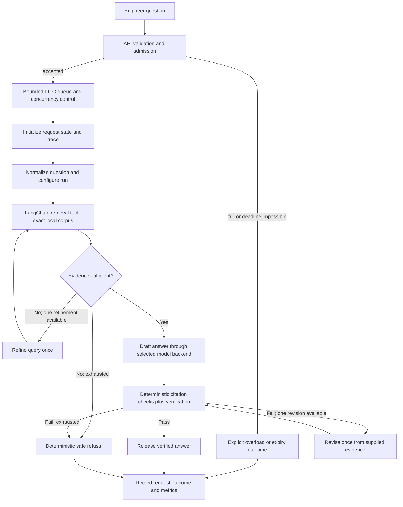
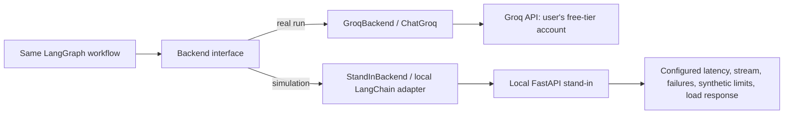

# Architecture — The Relay

## Status and alignment

This is the architecture proposed in `IMPLEMENTATION_PLAN.md`, checked against the authoritative assignment brief. It is a target architecture; Phase 1 project setup and corpus acquisition have started, but no assistant pipeline exists yet. The diagrams and component choices below do not add an alternate architecture.

## Design goals

- Answer engineering questions only from the three exact, versioned papers, with auditable page citations.
- Keep unsupported or invalid answers from reaching the user.
- Make work bounded and observable when the model provider or tools are slow, limited, or unavailable.
- Use one application workflow for both real Groq calls and clearly labelled local simulation.
- Preserve enough raw evidence to reproduce every reported metric.

## Component responsibilities

| Component | Responsibility | Main plan location |
|---|---|---|
| Configuration and secrets | Validate non-secret settings; load `GROQ_API_KEY` and `GROQ_MODEL` from environment; separate model, retrieval, queue, retry, and scenario configuration. | `config/`; `src/relay/config.py`; `.env.example` |
| API and schemas | Accept/validate question requests; present outcomes and typed request/response/metric fields. | `src/relay/api.py`, `schemas.py` |
| Admission/reliability | Bounded FIFO queue, concurrency and local RPM/TPM/day budgets, deadlines, cancellation and explicit bounded retry/backoff. | `src/relay/reliability/` |
| Paper ingestion | Load only required PDFs page-by-page; preserve paper ID/title/version/page; clean extraction conservatively and create a manifest. | `scripts/download_papers.py`; `src/relay/retrieval/ingest.py` |
| Chunking/index | Page-preserving chunks with stable IDs; local embeddings and persistent, rebuildable Chroma index with configuration manifest. | `src/relay/retrieval/chunking.py`, `index.py`; `data/` |
| Retrieval tool and citations | Explicit LangChain retrieval tool; bounded top-k and optional local reranker; deterministic citation-to-chunk/page validation. | `src/relay/retrieval/tools.py`, `citations.py` |
| Backend abstraction | Common interface for genuine `ChatGroq` inference and local simulator adapter; no secrets in traces; model/time/token metadata where available. | `src/relay/llm/` |
| LangGraph workflow | Typed shared state, focused nodes, explicit conditional edges, bounded refinement/revision and safe terminal outcomes. LangChain composes prompts, models, retriever, and tools. | `src/relay/graph/` |
| Stand-in service | Local FastAPI-compatible chat endpoint and streaming simulator; configurable delay, chunk pacing, failure, synthetic quotas, and load slowdown. | `src/relay/standin/` |
| Observability/results | UTC event times plus monotonic durations; request/stage traces, first token, retries, queue, usage provenance; one end-user row in required CSV. | `src/relay/observability/`; `experiments/raw/` |
| Evaluation/report | Paper-grounded questions and manual rubric; retrieval and load runners; deterministic metrics and figures/tables. | `src/relay/evaluation/`; `scripts/`; `experiments/`; `submissions/` |

## Request lifecycle



The graph's retrieval refinement and answer revision are strictly bounded to one each. Transport retries are a separate explicit reliability policy; they are not allowed after the user's deadline, on malformed/authentication requests, or after confirmed daily exhaustion. Draft streaming is held until the validation gate, so the first user-visible token may occur after model-generation tokens.

## Model backend boundary



Only backend selection and run profile vary. Retrieval, prompt/evidence rules, citation validation, workflow, and result schema remain common. The stand-in models observed external behavior; it does not claim to reproduce Groq's internal serving system. Simulation results must never be reported as real-provider measurements.

## Workflow nodes and state

The plan proposes focused nodes: `prepare_request`, deterministic `understand_question`/normalization, `retrieve_passages`, `check_evidence`, optional bounded `refine_query`, `draft_answer`, `verify_answer`, optional bounded `revise_answer`, `refuse_safely`, `finalize_response`, and `record_request`. This exceeds the assignment's minimum four steps and supplies a real tool invocation and conditional routing.

Shared typed state should carry request/scenario/backend/model/retrieval IDs; user and normalized queries; retrieved chunks and their paper/version/page metadata; evidence decision and attempt count; draft/verified response and validation findings; revision/refusal/final status; LLM call/retry/token counts; stage timestamps/durations; model and user-visible first-token timing; queue and cancellation/deadline state. It must not include API keys or broad environment dumps.

## Data and evidence flow

1. Exact versioned PDFs are retained as source material and identified in a manifest with source URL, date, size, and checksum.
2. Page-aware extracted records feed stable page-preserving chunks; local embeddings and index are rebuildable from the corpus and config.
3. Retrieval results carry chunk ID, paper ID/title/version, PDF page number, optional reliable section/printed-page data, and retrieval/reranking scores.
4. Model drafts cite supplied chunk IDs. The validator resolves IDs against retrieved metadata and checks paper version and page bounds before release.
5. Per-request records preserve required CSV fields. Additional telemetry and run/provider metadata support report calculations; real and stand-in sources remain distinguishable.
6. Metrics are generated from immutable raw records/configuration. Account limits and reset evidence are companion account-level data rather than fabricated per-request fields.

## Proposed repository mapping

The initial analysis inspection found only the source PDF and `IMPLEMENTATION_PLAN.md`. Phase 1 has since created the planned root configuration and scaffold. The plan's proposed implementation tree is:

```text
relay/
├── README.md
├── IMPLEMENTATION_PLAN.md
├── pyproject.toml
├── .env.example
├── .gitignore
├── config/                     # app, retrieval, scenarios
├── data/papers/                # original PDFs, processed pages, manifest
├── data/vectorstore/           # rebuildable local index
├── src/relay/
│   ├── api.py
│   ├── config.py
│   ├── schemas.py
│   ├── graph/                  # state, nodes, workflow
│   ├── retrieval/              # ingest, chunking, index, tools, citations
│   ├── llm/                    # backend, Groq, stand-in adapters
│   ├── reliability/            # admission, limiter, retry, deadlines
│   ├── standin/                # service, simulator, profiles
│   ├── observability/          # timing, logging, CSV writer
│   └── evaluation/             # questions, grading, runner
├── tests/{unit,integration,fixtures}/
├── scripts/                    # download, probe, load, metrics
├── experiments/{raw,summaries,figures}/
└── submissions/assistant_worklog.md
```

The plan does not define a documentation folder. The three requested analysis files were therefore placed at the project root. Phase 1 has created only plan-designated project folders and files.

## Proposed supporting technologies and external requirements

Python 3.11+ and compatible, pinned LangChain, LangGraph, and `langchain-groq` packages are required by the implementation instructions. The plan proposes FastAPI/Uvicorn, `httpx`, `pypdf` or tested equivalent, local Chroma, local sentence-transformer embeddings, optional local cross-encoder reranking, `asyncio`, pytest, and CSV/JSONL/YAML/Markdown. Versions were compatibility-checked on Python 3.12.14. The configured Groq model is accessible; successful headers confirmed RPD and TPM. RPM/TPD remain dated documentation references, while account concurrency and recovery remain unmeasured. The assignment also requires visiting Vaani in the reporting phase and retaining genuine assistant conversation material.

## Risks and design controls

| Risk | Architectural control |
|---|---|
| Wrong paper/version or page citation | Fixed corpus manifest, metadata on every chunk, deterministic citation resolution. |
| Unsupported plausible answer | Evidence sufficiency check, source-constrained prompt, citation validation, verification, bounded revision, safe refusal. |
| Free-tier quota exhaustion | Modest real probes, local budgets, stand-in for heavier scenarios, terminal daily-limit behavior. |
| Runaway workflow/retry | Explicit graph-attempt counters and retry limits; deadlines and cancellation. |
| Hidden retry/token behavior | Own retries in a single layer; preserve per-call traces and usage provenance. |
| Misleading simulator results | Calibrate from real samples; separate `source`; document synthetic assumptions and differences. |
| Incomplete result reproducibility | Required CSV fields plus additive telemetry, scenario config, run metadata, provider evidence, deterministic metric script. |
| PDF extraction defects | Inspect representative pages and retain source PDF/page metadata; document extraction limitations. |

## Analysis findings and open items

No substantive plan conflict with the assignment was identified. The plan's five load rows satisfy and extend the assignment's three example shapes; additive CSV fields retain the mandatory schema and enable recomputation. The model is verified as accessible, and a three-call real baseline plus response-header evidence are preserved. Some account-specific limits, daily recovery, and concurrency remain unmeasured. The assignment receipt date is still required to calculate the deadline. Phase 2 has not started and awaits review/explicit approval.
