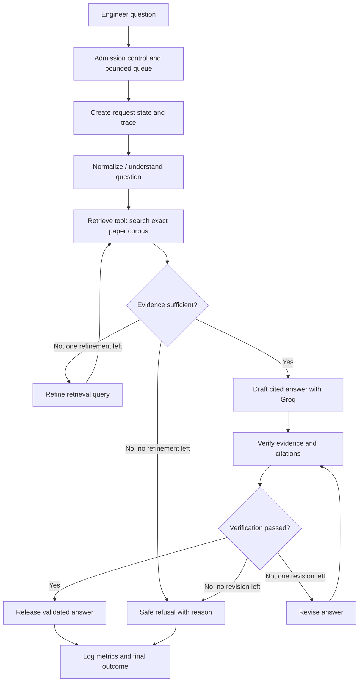

# The Relay — Detailed Implementation Plan

**Project:** The Relay — citation-grounded research assistant under constrained model capacity  
**Implementation language:** Python  
**LLM provider:** Groq API (free tier)  
**LLM framework:** LangChain  
**Workflow orchestration:** LangGraph (recommended and included)  
**Plan structure:** 5 phases × 10 tasks per phase  
**Status:** Planning document — no implementation or measurements are claimed here

---

## 0. Purpose of this document

This document translates the four-page Relay assignment brief into an actionable implementation roadmap. It defines what to build, in what order, how the pieces connect, how to verify each phase, and what evidence must be retained for the final submission.

The objective is **not merely to build a question-answering chatbot**. The objective is to build and measure a small, working, citation-grounded AI pipeline that remains controlled when model capacity is constrained, requests arrive in bursts, tools become slow, or provider limits are reached.

The project must demonstrate:

1. A multi-step research-question pipeline with at least four steps.
2. At least one real tool invocation and at least one conditional branch or bounded loop.
3. Retrieval from exactly the three paper versions specified in the assignment.
4. Real model calls through Groq, using a personal free-tier account and key.
5. A controllable stand-in model service for experiments that the real free tier cannot safely support.
6. Experiments that report latency, outcomes, tokens, retrieval quality, and failure behavior.
7. Raw results that allow reviewers to recompute reported performance figures.
8. A concise report whose design decisions are supported by measurements and can be defended in a live discussion.

This plan deliberately avoids adding infrastructure that the assignment does not need. The first implementation should be small, observable, reproducible, and easy to explain.

## 1. Assignment constraints that govern every phase

Treat these as non-negotiable acceptance requirements:

- The paper library contains only these exact versions:
  - **Attention Is All You Need** — arXiv `1706.03762`, version `7`.
  - **Moshi: a speech-text foundation model for real-time dialogue** — arXiv `2410.00037`, version `1`.
  - **Dynamic Chunking for End-to-End Hierarchical Sequence Modeling** — arXiv `2507.07955`, version `2`.
- The assistant must cite the paper location supporting every substantive answer. When the library does not contain the answer, it must say so rather than guess.
- Use a real hosted model on Groq's free tier. Do not use extra accounts or any method of bypassing the provider's limits.
- First measure the real service using a modest, controlled number of requests. Do not send an uncontrolled load test to the free-tier service.
- The stand-in must be configurable to be slow, fail, reject requests when a limit is reached, slow down under load, and stream output piece by piece.
- The load experiment must cover at least these five rows: steady load, burst, sustained overload, per-minute limit halved, and daily budget exhausted.
- Compare at least three retrieval settings, including piece size, number of pieces, and re-ranking behavior.
- Create at least 15 evaluation questions.
- Keep the required `results.csv` with one row per request and all required columns.
- Include all required report headings, the Vaani feedback, and the genuine assistant conversation history / prompt record.
- Keep the main written report to a maximum of two pages. Code, raw results, and conversation history are supporting materials.
- Never commit or submit the Groq API key.

The brief expects roughly 6–8 hours of work. That is a target for a focused minimum implementation, not a guarantee: unexpected package, PDF extraction, or free-tier issues may take longer. The four-day submission deadline must be calculated from the actual date the brief was received.

## 2. Technology decisions

### 2.1 Selected stack

| Concern | Selected technology | Why it is used |
|---|---|---|
| Main language | Python | Fast implementation and a mature LangChain / LangGraph ecosystem. |
| LLM composition | LangChain | Reusable prompts, chat-model interface, output parsing, retriever and tool abstractions. |
| Workflow | LangGraph | The assignment needs explicit state, branching, and bounded loops for retrieval recovery and answer verification. |
| Real model | Groq API through `langchain-groq` and `ChatGroq` | This is the provider and API required by the assignment. |
| PDF extraction | LangChain PDF loader backed by `pypdf` (or a tested equivalent) | Load the exact paper PDFs while retaining page metadata. |
| Vector retrieval | Local Chroma vector store | Keeps the three-paper corpus local and avoids depending on a hosted vector database. |
| Embeddings | A small local sentence-transformer model | Avoids spending Groq request/token quota on embedding calls. Record its exact model ID and revision. |
| Optional re-ranking | A small local cross-encoder | Allows a measurable re-ranking experiment without extra Groq requests. Record model and compute time. |
| API / test server | FastAPI + Uvicorn | Provides a small request endpoint and a separate stand-in service. |
| Async and concurrency | `asyncio` plus bounded queue / semaphore | Supports queueing, deadlines, concurrency caps, and request cancellation. |
| HTTP client | `httpx` | Used for controlled probes and load generation where appropriate. |
| Tests | `pytest` | Unit, integration, and repeatability checks. |
| Data and reports | CSV, JSONL, YAML, Markdown | Keeps measurements inspectable and easy to submit. |

### 2.2 Why LangGraph is justified

Use **LangChain for the components** and **LangGraph for the workflow**. This project has several paths that should be visible and testable:

- A normal evidence-supported answer path.
- A weak-evidence path that can refine the search once and retrieve again.
- A refusal path when the papers do not support an answer.
- A verification-failure path that can attempt one controlled revision and then refuse safely.
- Error and rate-limit paths that must terminate predictably rather than loop indefinitely.

A simple linear LangChain chain would work for a basic RAG demo, but it would make the required branching, retry state, and execution accounting less explicit. LangGraph is therefore appropriate here. Do not build a multi-agent system; a single graph with small, focused nodes is sufficient.

### 2.3 Groq integration decision

Use the LangChain integration package and `ChatGroq` for all real inference calls:

```python
from langchain_groq import ChatGroq

llm = ChatGroq(
    model_name=MODEL_NAME,
    temperature=0,
    # Set timeout and retry behavior explicitly after verifying
    # the installed integration's supported arguments.
)
```

Do not copy a model name from an old tutorial and assume it is still available on the free tier. Choose a model that is available to the account on implementation day, supports the API features the pipeline needs, and has limits that leave enough room for the experiments. Store it in configuration as `GROQ_MODEL` and record the exact model ID in every run's metadata.

Disable hidden SDK / framework retries where possible, or configure them explicitly, so the application can count and report every retry itself. Confirm the relevant constructor arguments in the installed `langchain-groq` version before relying on them.

### 2.4 Stand-in integration decision

The stand-in is **not** a second hosted LLM and does not need another paid or free provider account. Implement it as a local FastAPI service exposing an OpenAI-compatible chat-completions endpoint, including streaming server-sent events. For stand-in runs, connect LangChain's `ChatOpenAI` integration to the local base URL. This does not call OpenAI; it calls the local simulator. Alternatively, a custom LangChain chat-model adapter may be used if the OpenAI-compatible route becomes a distraction.

Keep a common internal model-backend interface so the same LangGraph workflow can run against either:

- `GroqBackend` → `ChatGroq` → real Groq API.
- `StandInBackend` → local FastAPI simulator → simulated model behavior.

The rest of the pipeline must not have separate retrieval or answer logic for real versus stand-in runs. Only the model backend and scenario configuration should change.

### 2.5 Important implementation boundary

The stand-in is an approximation of the observed service, not a claim to reproduce Groq's internal infrastructure. It should reproduce externally visible behavior relevant to the experiment: latency distributions, stream timing, configured failures, quota responses, and load-dependent slowdown. Document the behaviors it cannot reproduce accurately.

---

## 3. Target architecture

### 3.1 High-level request lifecycle



This diagram is a target design, not a report of completed work. The graph must have explicit maximum counts for retrieval refinement and answer revision. Neither loop may run forever.

### 3.2 LangGraph nodes and responsibilities

| Node | Responsibility | Model call? |
|---|---|---:|
| `prepare_request` | Validate input, assign request ID, normalize whitespace, apply request limits, and initialize timestamps. | No |
| `understand_question` | Produce a concise task classification and retrieval query (or normalized query) without answering from general knowledge. | Optional; keep deterministic in the first version if quota is tight. |
| `retrieve_passages` | Invoke the LangChain retrieval tool against the selected retrieval configuration. | No |
| `check_evidence` | Check result count, similarity threshold, paper coverage, and whether useful citations are available. | No |
| `refine_query` | Produce one alternative query only when initial retrieval is weak. | Optional LLM call; strictly bounded to one. |
| `draft_answer` | Answer only from retrieved passages and attach source identifiers / page locations. | Yes — Groq. |
| `verify_answer` | Check that cited source IDs exist and assess whether each factual statement is supported by the supplied passages. | Yes — Groq review plus deterministic citation checks. |
| `revise_answer` | Make one evidence-grounded correction after a failed verification. | Yes — Groq, only on the exceptional path. |
| `refuse_safely` | Return an explicit refusal when evidence is absent or validation cannot pass. | No; deterministic template. |
| `finalize_response` | Release only a verified answer or a clearly labelled refusal / fallback. | No |
| `record_request` | Write request, stage timing, token, retry, queue, and outcome data. | No |

Keep the first implementation to two model calls on the normal answer path: one answer-generation call and one verification call. Query understanding should initially be deterministic or folded into retrieval-query normalization. The optional query-refinement and answer-revision calls are exceptional and must be counted. This controls the free-tier budget while still demonstrating a multi-call pipeline.

### 3.3 Shared graph state

Use a typed state schema (for example, a `TypedDict` or the schema style supported by the installed LangGraph version). Keep raw values in state; build formatted prompts inside nodes.

Minimum state fields:

- `request_id`, `scenario`, `source`, `retrieval_setting`, `model_name`.
- `user_query`, `normalized_query`, `alternate_query`.
- `retrieved_documents` and metadata for each document.
- `evidence_sufficient`, `retrieval_attempts`.
- `draft_answer`, `verified_answer`, `verification_passed`, `verification_issues`.
- `revision_attempts`, `refusal_reason`, `final_response`, `final_status`.
- `llm_call_count`, `retry_count`, `tokens_in`, `tokens_out`.
- Stage timestamps and accumulated durations.
- `first_model_token_ms`, `first_user_token_ms`, and `total_ms`.
- Queue measurements and cancellation / abandonment flags.

Do not store API keys, complete environment dumps, or unnecessary personal data in graph state or logs.

### 3.4 Retrieval tool contract

Expose retrieval as an explicit LangChain tool, such as `search_research_library`. It should accept a query, retrieval setting, and optional top-k override, and return a list of passage objects containing:

- `paper_id` and paper title.
- `arxiv_version`.
- `pdf_page_number` (1-based PDF page index).
- `printed_page_number` if it can be identified reliably; otherwise leave it absent.
- `section_title` if extraction identifies it reliably; otherwise leave it absent.
- `chunk_id`, `chunk_text`, and retrieval score.

The graph must invoke the tool explicitly and record that invocation. Do not rely on an LLM spontaneously deciding to call the retrieval function; predictable retrieval is easier to evaluate and defend.

### 3.5 Answer and citation contract

The answer prompt must state that the three supplied papers are the only permitted factual source. It must instruct the model to:

- Use only the retrieved passages.
- Distinguish direct evidence from cautious synthesis.
- Cite every substantive claim with paper title/ID, version, and page location.
- Never manufacture a page, section, quote, result, or citation.
- Say that the library does not provide the answer when evidence is insufficient.

The deterministic validator must reject citations that reference unknown chunk IDs, wrong paper versions, missing pages, or pages outside the downloaded paper. The verification model is a second check, not a replacement for deterministic validation. Do not release the draft to the user before the validation path has completed.

---

## 4. Proposed repository layout

Keep the structure clear without creating a separate module for every tiny function. The following is a suggested layout; combine files where that makes the implementation simpler.

```text
relay/
├── README.md
├── IMPLEMENTATION_PLAN.md
├── pyproject.toml                 # dependencies and pinned tested versions
├── .env.example                  # variable names only; no real secrets
├── .gitignore
├── config/
│   ├── app.yaml                  # model, queue, timeout, retry settings
│   ├── retrieval.yaml            # chunking / top-k / reranker configurations
│   └── scenarios.yaml            # load scenarios and stand-in profiles
├── data/
│   ├── papers/original/          # exact versioned PDFs
│   ├── papers/processed/         # extracted page text / manifest
│   └── vectorstore/              # local persisted index (rebuildable)
├── src/relay/
│   ├── api.py                    # request endpoint
│   ├── config.py                 # validated configuration loading
│   ├── schemas.py                # request / response / metric schemas
│   ├── graph/
│   │   ├── state.py
│   │   ├── nodes.py
│   │   └── workflow.py
│   ├── retrieval/
│   │   ├── ingest.py
│   │   ├── chunking.py
│   │   ├── index.py
│   │   ├── tools.py
│   │   └── citations.py
│   ├── llm/
│   │   ├── backend.py
│   │   ├── groq_backend.py
│   │   └── standin_backend.py
│   ├── reliability/
│   │   ├── admission.py
│   │   ├── limiter.py
│   │   ├── retry.py
│   │   └── deadlines.py
│   ├── standin/
│   │   ├── app.py
│   │   ├── simulator.py
│   │   └── profiles.py
│   ├── observability/
│   │   ├── timing.py
│   │   ├── logging.py
│   │   └── csv_writer.py
│   └── evaluation/
│       ├── questions.yaml
│       ├── grading.py
│       └── run_eval.py
├── tests/
│   ├── unit/
│   ├── integration/
│   └── fixtures/
├── scripts/
│   ├── download_papers.py
│   ├── probe_groq.py
│   ├── run_load_test.py
│   └── build_report_metrics.py
├── experiments/
│   ├── raw/
│   ├── summaries/
│   └── figures/
└── submissions/
    └── assistant_worklog.md
```

**Data hygiene:** Keep downloaded PDFs, extracted text, and vector indexes separate. The vector index must be rebuildable from the original PDFs and configuration. Commit neither `.env` nor API keys. Do not submit a cache or generated index as a substitute for the original PDF manifest and reproducible ingestion script.

---

# PHASE 1 — Project setup, corpus acquisition, and real Groq baseline

**Phase objective:** Establish a reproducible Python/LangChain project, obtain the exact three paper versions, inspect their structure, configure Groq safely, and collect a modest baseline of real-service observations before building the simulator.

**Expected outputs:** Working environment, repository skeleton, exact PDF corpus, corpus manifest, Groq account/model configuration, initial real-service probe data, and a written record of observed limits and uncertainty.

## Task 1.1 — Confirm deadline, scope, and acceptance checklist

**Actions**
- Record the date the assignment was received and calculate the four-day deadline.
- Create a checklist from every mandatory item in the original brief.
- Mark requirements as `must build`, `must measure`, `must report`, or `must preserve as raw evidence`.
- Decide a realistic time budget within the brief's 6–8-hour expectation.
- Keep a separate list of optional work so it cannot displace mandatory requirements.

**Done when**
- The deadline and task checklist are written down.
- Every required result table, load scenario, retrieval experiment, CSV field, report heading, and submission item has an owner/task in this plan.

## Task 1.2 — Create the Python project and virtual environment

**Actions**
- Create the `relay/` repository and a virtual environment.
- Choose a Python version supported by the selected LangChain, LangGraph, and Groq integration packages.
- Create `pyproject.toml` or a requirements file.
- Use explicit dependency versions after the first working install; record the tested environment.
- Add a minimal command that imports the main packages and exits successfully.

**Done when**
- A fresh environment can install the dependencies and import LangChain, LangGraph, and `langchain_groq`.
- The exact Python and package versions are recorded.

## Task 1.3 — Install and verify the chosen framework integrations

**Actions**
- Install the core LangChain packages, `langgraph`, and `langchain-groq`.
- Install the PDF loader dependencies, local embedding / vector-store dependencies, FastAPI, Uvicorn, `httpx`, and `pytest`.
- Install `langchain-openai` only for the local OpenAI-compatible stand-in adapter if that design is used.
- Run one small import test for `ChatGroq`, graph construction, prompt templates, message objects, and the local model adapter.
- Check the installed docs / signatures for timeout, retry, streaming, and usage metadata behavior before using those options.

**Done when**
- A minimal smoke-test script imports every selected integration.
- The dependency list contains only packages actually used by the project.

## Task 1.4 — Create configuration and secret-handling files

**Actions**
- Add `.env.example` with variable names such as `GROQ_API_KEY`, `GROQ_MODEL`, and local stand-in settings, but no real key.
- Add `.env`, local result files, caches, and secrets to `.gitignore`.
- Load secrets from environment variables; never hard-code them in source, prompts, notebooks, logs, or the final report.
- Separate environment secrets from non-secret settings such as timeout, top-k, queue size, and scenario definitions.
- Add a startup check that fails with a clear message when the Groq key or model name is missing for a real run.

**Done when**
- A local real run can read the key from the environment.
- A repository scan finds no real API key.

## Task 1.5 — Download the three exact arXiv PDF versions

**Actions**
- Download the versioned PDF for `1706.03762v7`.
- Download the versioned PDF for `2410.00037v1`.
- Download the versioned PDF for `2507.07955v2`.
- Save the original files under `data/papers/original/` with unambiguous filenames.
- Do not silently replace a required version with the latest paper version.

**Done when**
- Exactly three paper PDFs are present.
- Each filename and download URL clearly encode the required arXiv ID and version.

## Task 1.6 — Verify PDF identity and create a corpus manifest

**Actions**
- Inspect each PDF's first page and metadata to verify title and arXiv identifier.
- Record the required version, source URL, local filename, download date, file size, and SHA-256 checksum.
- Confirm that none of the PDFs is truncated or an HTML error page saved with a `.pdf` extension.
- Store the manifest as `data/papers/manifest.json` or CSV.

**Done when**
- Every file is verifiably the specified paper version.
- The manifest allows another person to verify the exact corpus used in the experiments.

## Task 1.7 — Inspect paper structure and PDF extraction quality

**Actions**
- Extract page text from each paper with the selected PDF loader.
- Inspect the title page, abstract, one technical section, tables/figures, and final pages from each paper.
- Note extraction defects such as broken columns, ligatures, missing symbols, repeated headers, or page-number confusion.
- Preserve page-level metadata. Prefer splitting each page independently so a chunk does not accidentally combine two paper pages.
- Record that PDF page index and printed page label may differ; never invent a printed page number.

**Done when**
- Extracted text is readable enough for retrieval.
- Known extraction limitations are documented.
- The ingestion process retains a defensible page locator for citations.

## Task 1.8 — Create a Groq account and verify the current free-tier model options

**Actions**
- Use the user's own free Groq account and create one API key.
- Inspect the current model availability and the account's free-plan limits in the Groq console.
- Choose one model for the experiment and store its exact model ID in `GROQ_MODEL`.
- Confirm that the model supports the chat-completion and streaming behavior required by the adapter.
- Record the date, account plan, chosen model, and the source used to establish its limits.

**Done when**
- A small authenticated request succeeds through `ChatGroq`.
- The chosen model and account configuration are recorded without exposing the key.

## Task 1.9 — Perform a modest real-service baseline probe

**Actions**
- Send a small, pre-budgeted number of requests with fixed, short prompts and controlled output lengths.
- Capture request start, first streamed model chunk, completion time, status, model ID, input/output token usage, and any returned rate-limit metadata.
- Avoid a burst or an intentional daily-budget exhaustion against the free-tier account.
- Keep raw probe records separate from simulated load-test results.
- Repeat only when the initial measurements are too sparse to characterize basic latency.

**Done when**
- There is a raw baseline dataset from actual Groq calls.
- Its request count, timestamps, model, prompt style, and limitations are recorded.

## Task 1.10 — Document observed limits and uncertainty

**Actions**
- Record requests/minute, tokens/minute, requests/day, tokens/day, and any input/output token split shown for the account/model.
- Record whether the console or responses reveal a concurrency limit. If it is not specified or safely measured, write `not publicly specified` or `not measured`; do not invent a value.
- Inspect response status and headers from ordinary calls. If a rate-limit response is naturally encountered, preserve the status, body, `Retry-After`, and other relevant headers.
- Record how recovery was established: provider reset metadata, account dashboard, a later successful request, or `not measured`.
- Separate official documentation values, account-console values, and experimentally observed values. Add a confidence rating to each.

**Done when**
- Table 1 can be populated with evidence and confidence, including honest `not measured` values where necessary.
- The stand-in has measured baseline inputs for latency and streaming calibration.

**Phase 1 gate:** Do not begin a large set of real calls until the daily budget and model limits are known well enough to plan the remaining experiments.

---

# PHASE 2 — Local research corpus, RAG retrieval, and LangGraph assistant

**Phase objective:** Build the evidence-grounded answer pipeline using LangChain components and a LangGraph workflow. The normal path must retrieve passages, produce a cited answer, and validate it before release.

**Expected outputs:** Rebuildable local index, three retrieval configurations, explicit retrieval tool, compiled LangGraph workflow, safe refusal behavior, citation validation, and working real-Groq end-to-end path.

## Task 2.1 — Implement page-aware PDF ingestion

**Actions**
- Load each PDF and create one document record per page.
- Attach `paper_id`, `title`, `arxiv_version`, `pdf_page_number`, source filename, and extraction timestamp.
- Extract section headings where possible, but keep them optional if the PDF layout makes detection unreliable.
- Normalize repeated whitespace and obvious extraction artifacts without changing the technical meaning.
- Keep the unmodified PDF as the authoritative source.

**Done when**
- The same three PDFs can be re-ingested with stable paper/version/page metadata.
- A developer can trace every extracted page back to its source PDF.

## Task 2.2 — Implement configurable chunking

**Actions**
- Use a LangChain text splitter with clearly defined chunk size and overlap.
- Keep chunks within a page boundary so a citation has a simple page locator.
- Assign a stable `chunk_id` derived from paper ID, version, page number, and chunk index.
- Store chunk text and all source metadata alongside the vector record.
- Log chunk count, average chunk length, and empty/very short chunks for each paper.

**Done when**
- A chunk can be traced to one paper version and one PDF page.
- Changing chunk-size configuration rebuilds the index rather than mixing old and new chunking settings.

## Task 2.3 — Build the local embedding and vector index

**Actions**
- Select a small local embedding model and record its model ID and revision.
- Generate embeddings locally so retrieval does not consume Groq API quota.
- Store vectors and metadata in a local Chroma collection (or another local vector store only if a tested compatibility issue requires it).
- Add a deterministic index-build script and a clear rebuild command.
- Include the embedding model and chunk configuration in the index manifest so incompatible indexes are not reused accidentally.

**Done when**
- The full three-paper corpus can be indexed locally.
- A fresh index produces search results with source metadata intact.

## Task 2.4 — Define the three required retrieval settings

**Actions**
- Define at least three explicit settings in `config/retrieval.yaml`.
- Suggested initial comparison:

  | Setting | Chunk size | Overlap | Top-k | Re-ranking |
  |---|---:|---:|---:|---|
  | `small_fast` | 600 characters | 100 characters | 3 | No |
  | `medium` | 1,000 characters | 150 characters | 3 | No |
  | `medium_reranked` | 1,000 characters | 150 characters | 5 candidates, then keep best 3 | Yes |

- Treat these as starting values, not results. Adjust only if inspection shows they are unsuitable, and record the final values.
- Use the same evaluation questions across settings wherever the real API budget allows, so comparisons are not distorted by different question difficulty.

**Done when**
- Each setting can be selected by name at runtime.
- Chunk size, overlap, top-k, and reranker use are written into run metadata and the results CSV.

## Task 2.5 — Implement optional local re-ranking

**Actions**
- Add a small local cross-encoder reranker, or another explicit and reproducible local re-ranking method.
- Re-rank only the bounded candidate set returned by vector retrieval.
- Keep the original retrieval score and reranker score for analysis.
- Measure reranker compute time separately from embedding retrieval time.
- Confirm that the reranker does not call Groq or another hosted model.

**Done when**
- The no-rerank and rerank settings produce distinguishable, logged behavior.
- Re-ranking latency is measured and included in the end-to-end timing breakdown.

## Task 2.6 — Implement retrieval as an explicit LangChain tool

**Actions**
- Create `search_research_library` as a LangChain tool with a validated input schema.
- Make the tool select the requested retrieval configuration and return the top passages with their page metadata and scores.
- Reject unknown paper IDs or invalid retrieval-setting names.
- Add a tool execution record to each request trace.
- Avoid fetching from websites or other paper libraries during answering; the allowed corpus is fixed.

**Done when**
- The graph invokes a real tool object and receives typed passage results.
- Tool invocation count and tool latency are captured.

## Task 2.7 — Build citation formatting and deterministic citation validation

**Actions**
- Define a single citation format that contains the paper title or short title, arXiv ID/version, and PDF page locator.
- Map each generated citation back to a retrieved `chunk_id`.
- Reject unknown paper versions, unknown chunk IDs, missing page values, and page values outside the source PDF.
- Preserve original source metadata; do not ask the LLM to invent page numbers.
- Add unit tests for valid citations, wrong-version citations, missing pages, and fabricated source IDs.

**Done when**
- Every citation in a released answer can be resolved to a real retrieved chunk and original PDF page.
- Invalid citations fail validation.

## Task 2.8 — Create answer and refusal prompts

**Actions**
- Write a concise system prompt that restricts factual claims to the retrieved paper passages.
- Require claim-level citations and clear separation between evidence and inference.
- Add an explicit out-of-library refusal instruction.
- Require the model to return a structured draft containing answer text and citation identifiers, or use an output parser to validate a predictable format.
- Keep prompts versioned in source control and record their version/hash in each experiment.

**Done when**
- A known answerable question produces a cited draft.
- A known unanswerable question produces a clear refusal instead of a guessed response.

## Task 2.9 — Implement the LangGraph workflow and bounded branches

**Actions**
- Define the shared graph state and small node functions.
- Add the retrieval tool node, evidence sufficiency decision, answer-generation node, and verification node.
- Add a maximum of one query-refinement/retrieval retry for weak initial evidence.
- Add a maximum of one answer revision if verification fails; after that, refuse safely.
- Route unsupported questions to the deterministic refusal node.
- Compile the graph and write a graph-level integration test for every branch.

**Done when**
- The normal path, insufficient-evidence path, query-refinement loop, verification failure, and safe refusal all terminate predictably.
- The graph has at least four explicit steps, a tool call, and a conditional branch/loop.

## Task 2.10 — Run an end-to-end correctness smoke test with Groq

**Actions**
- Run a small number of manually chosen questions through the real `ChatGroq` backend.
- Include one question answerable from each paper and one question that the corpus does not answer.
- Confirm that the final answer is not streamed to the user before the verification gate passes.
- Verify source IDs, versions, page locations, and refusal behavior manually against the PDFs.
- Save the prompts, outputs, logs, and any correction made to the implementation in the assistant worklog.

**Done when**
- The pipeline produces a verified cited answer for supported questions and a safe refusal for unsupported questions.
- All model calls in the smoke test are counted and included in the usage budget.

**Phase 2 gate:** The assistant must be correct on a small manual sample before load testing. Do not use performance experiments to hide a citation or grounding defect.

---

# PHASE 3 — Request control, reliability, observability, and stand-in model service

**Phase objective:** Add the engineering controls that make the system measurable under pressure, then build a local stand-in calibrated from the real-service observations collected in Phase 1.

**Expected outputs:** Bounded admission queue, concurrency and token/request controls, explicit retry policy, cancellation and deadline handling, complete telemetry, a configurable streaming stand-in, and calibration notes.

## Task 3.1 — Add a request admission layer and bounded FIFO queue

**Actions**
- Put request acceptance in front of LangGraph execution.
- Use a bounded queue with a configurable maximum length.
- Use FIFO ordering for the first implementation; do not add a complex priority scheduler without measured need.
- Record enqueue time, dequeue time, queue depth at arrival, and queue-wait duration.
- Define what happens when the queue is full: return a clear overload response promptly rather than silently discarding the request.

**Done when**
- Concurrent requests enter a controlled queue.
- Queue wait and rejected-on-admission outcomes are visible in logs and CSV.

## Task 3.2 — Add concurrency, request-rate, and token-budget controls

**Actions**
- Add a configurable semaphore for maximum in-flight model calls.
- Add a local request-per-minute limiter and token-per-minute accounting based on the best available usage estimate.
- Add a daily local budget counter with a safety margin below the observed provider limit.
- Count each model call, not only each end-user question, because one user question may make multiple Groq requests.
- Persist daily usage state across application restarts for the experiment and note that it may not include usage outside this program or other applications sharing the account.

**Done when**
- The application can be configured to run below, at, and above simulated capacity.
- Model-call counts and token usage are consistent with the raw request traces.

## Task 3.3 — Implement request deadlines and user-abandonment handling

**Actions**
- Define an end-to-end request deadline and per-model-call timeout.
- Propagate cancellation when a client disconnects or the request deadline expires.
- Avoid retrying work that no longer has a waiting user or enough time to complete.
- Distinguish queue timeout, model timeout, client abandonment, and server error in an outcome field.
- Ensure cancelled tasks release queue slots and concurrency permits.

**Done when**
- A timed-out or abandoned request cannot hold a worker indefinitely.
- Abandonment and timeout are distinguishable in raw data even though the required `status` column has a smaller allowed vocabulary.

## Task 3.4 — Implement explicit, bounded retry behavior

**Actions**
- Turn off or explicitly control hidden retries inside the model integration so the application owns retry accounting.
- Classify failures into transient network/5xx, minute-window rate limit, daily-budget exhaustion, authentication/permission errors, invalid request, and terminal timeout.
- For a transient failure, retry only when the retry delay fits the request deadline and the remaining local budget.
- Respect `Retry-After` when present; otherwise use bounded exponential backoff with jitter.
- Do not retry authentication errors, malformed requests, or a confirmed daily-budget exhaustion.
- Set a small maximum retry count and record every attempt, wait, status, and token cost.

**Done when**
- The retry policy is deterministic and tested.
- A request cannot enter an unbounded retry loop.
- The raw metrics show when retries made latency, queueing, or token consumption worse.

## Task 3.5 — Add structured per-request and per-stage telemetry

**Actions**
- Use `time.monotonic()` (or an equivalent monotonic clock) for durations and UTC timestamps for recorded event times.
- Record queue waiting, active work, retrieval, each LLM call, retry backoff, verification, and final response release separately.
- Capture first model token time from the model stream and first user-visible token time from the final validated response.
- Capture input/output tokens from provider usage metadata where available; if unavailable, estimate with a named tokenizer and mark the source as estimated.
- Record all model calls and retries rolled up to the user request while preserving detailed per-call traces in JSONL.

**Done when**
- A slow request can be decomposed into waiting, working, and retrying time.
- First-token and total-time calculations have documented start/end definitions.

## Task 3.6 — Design the required `results.csv` and additional raw telemetry fields

**Actions**
- Preserve every mandatory column exactly:

  `request_id, scenario, source, start_time, first_token_ms, total_ms, status, retries, tokens_in, tokens_out, retrieval_setting, answer_grade`

- Add extra columns needed to make the reported tables auditable. Recommended fields:

  - `user_outcome` — success, refused, rejected, timed_out, abandoned, fallback, or error.
  - `queue_wait_ms`, `active_work_ms`, `retry_wait_ms`, `retrieval_ms`, `verification_ms`.
  - `first_model_token_ms`, `first_user_token_ms` (the required `first_token_ms` should have one clearly documented definition).
  - `llm_calls`, `queue_depth_at_arrival`, `peak_queue_length`.
  - `model_name`, `prompt_version`, `tokens_source`, `estimated_cost_usd`, `cost_basis`.
  - `answer_grade` using only the assignment's allowed values: `correct`, `wrong`, `refused_correctly`, `refused_wrongly`.
  - `error_class`, `http_status`, and `retry_after_s` where applicable.

- Ensure one row represents one end-user request, not one model call. Aggregate all model calls and retries for that request into `llm_calls`, token totals, retry totals, and accumulated timing fields.
- Use a blank / null value for first-token time when no token was emitted; do not substitute zero.
- Write a schema test that checks required column names, allowed statuses, allowed answer grades, and one-row-per-request behavior.

**Important data-schema limitation:** The assignment's mandatory CSV columns alone do not contain enough information to reconstruct every requested metric (for example, queue wait, work time, retry wait, abandonment, pricing basis, and provider-limit evidence). Preserve the required `results.csv` format and add the additional per-request fields above. Also keep a small companion evidence file such as `provider_limit_evidence.csv` or `provider_limit_evidence.json` for account-level limits and recovery observations that are not naturally per-request. In the two-page report, state this transparently. Do not fabricate a per-request value for an account-level observation.

**Done when**
- The CSV can regenerate the performance tables' request counts, latency percentiles, failures, token use, retries, queue peak, and cost calculation.
- Companion evidence makes Table 1 auditable where a value is not an individual request measurement.

## Task 3.7 — Build the local stand-in API service

**Actions**
- Implement a FastAPI endpoint compatible with the chat-completions request shape used by the local LangChain adapter.
- Support normal JSON responses and streaming server-sent events, including a clear stream terminator.
- Return realistic response objects with model metadata and token-usage fields.
- Support configurable response delays, inter-chunk delays, forced failures, and configured rate-limit responses.
- Keep a deterministic simulation seed and record the stand-in profile used in each run.

**Done when**
- The stand-in can be selected as the LangChain backend without changing the LangGraph workflow.
- Both streamed and non-streamed calls pass integration tests.

## Task 3.8 — Implement stand-in load behavior and failure modes

**Actions**
- Add configurable RPM, TPM, RPD, TPD, and concurrent-request caps to the simulator. These are simulated scenario parameters, not claims about Groq's real internal limits.
- Return HTTP 429 and relevant synthetic reset / retry metadata when configured limits are reached.
- Increase response delay under concurrency or queue pressure using a documented model, such as a base latency distribution plus a load-dependent delay term.
- Support timeout, connection-style error, server error, and partial/slow stream scenarios.
- Provide a way to reset simulator counters between experiments without changing the recorded configuration.

**Done when**
- Every behavior explicitly required of the stand-in can be triggered independently and in combination.
- Scenario behavior is reproducible from its configuration and seed.

## Task 3.9 — Calibrate the stand-in from measured Groq behavior

**Actions**
- Use Phase 1 real-service measurements to estimate first-token latency, total latency, output pacing, and normal token usage.
- Prefer empirical distributions (for example, sampled observed latencies) over one fixed constant delay.
- Calibrate separate first-token and inter-token timing where sample size permits.
- Set failure and quota behavior from documented limits and observed responses; label any failure probability or concurrency curve that is an experimental assumption rather than an observed Groq fact.
- Save calibration values, source sample IDs, and caveats in `config/standin_profile.yaml`.

**Done when**
- The stand-in has traceable calibration inputs.
- The report can explain where it resembles the real service and where it is least like it.

## Task 3.10 — Test overload, cancellation, retries, and logging end to end

**Actions**
- Run controlled local tests for queue growth, queue-full rejection, concurrency caps, minute-style 429, daily-budget exhaustion, timeouts, and slow streaming.
- Force one retryable failure and confirm the retry count and backoff duration.
- Force a daily limit and confirm the application does not continue retrying.
- Check that a slow request's `total_ms` reconciles with queue wait + active work + retry wait, allowing only documented instrumentation overhead.
- Check that every accepted or rejected request ends with one raw result record.

**Done when**
- The reliability layer and telemetry are stable enough for load experiments.
- No test creates an uncontrolled call to the real Groq service.

**Phase 3 gate:** The same graph must run through both backends; the stand-in must be sufficiently calibrated and observable before the heavy scenarios begin.

---

# PHASE 4 — Evaluation dataset, retrieval experiments, and load testing

**Phase objective:** Produce repeatable evidence about answer quality, retrieval cost, latency, and behavior under constrained capacity. Real Groq tests remain modest; the stand-in carries the heavy load scenarios.

**Expected outputs:** A documented question set of at least 15 questions, answer-quality grades, three or more retrieval-setting results, five load scenarios, raw request-level records, and reproducible metric summaries.

## Task 4.1 — Create at least 15 evaluation questions

**Actions**
- Read the actual papers and write at least 15 questions that are answerable or unanswerable based on their content.
- Include direct factual questions, questions requiring details from a technical section, cross-section synthesis, and questions that sound plausible but are not answered by the library.
- Include questions that distinguish the three papers' terminology so retrieval confusion can be detected.
- For every question, record its expected answer status, source paper/version, relevant pages or sections, and a short grading note.
- Do not create paper-specific claims from memory; ground each expected answer in the actual PDF.

**Done when**
- The dataset contains at least 15 original questions.
- Each question has an evidence-backed reference answer or an explanation that the library does not answer it.

## Task 4.2 — Define a consistent answer-quality rubric

**Actions**
- Use the four required grades: `correct`, `wrong`, `refused_correctly`, and `refused_wrongly`.
- Define `correct` as an answer that is substantively supported and correctly cited.
- Define `wrong` to include unsupported factual claims, wrong citations, wrong paper version, or a confidently fabricated response.
- Define `refused_correctly` as a refusal when the corpus does not support the requested information.
- Define `refused_wrongly` as a refusal when the required evidence is present and retrievable.
- Grade outputs manually against the PDF evidence. An LLM grader may be a secondary diagnostic but must not be the sole source of ground truth.

**Done when**
- Two people could apply the rubric consistently from the question, answer, and source pages.
- All graded answers have a short reason for the assigned grade.

## Task 4.3 — Run the retrieval-quality comparison

**Actions**
- Run the evaluation questions under each configured retrieval setting.
- Use the same question set across settings whenever the Groq usage budget allows.
- Record retrieved chunk IDs, scores, reranker scores, prompt token use, answer token use, first-token latency, total latency, and final grade.
- Keep the model, prompt version, decoding settings, and grading rubric constant while changing the retrieval setting.
- If the free-tier budget prevents a full cross-product, use a clearly disclosed, balanced subset for each setting and do not compare unequal samples as if they were identical.

**Done when**
- Table 3 can be filled for at least three retrieval configurations.
- Each row has a known question count and comparable grading method.

## Task 4.4 — Examine naive-retriever failure modes

**Actions**
- Inspect retrieval results for questions where the top result is lexically similar but semantically wrong.
- Identify three distinct failure patterns in this exact three-paper library.
- For each, preserve an example question, the misleading retrieved passage, the correct passage (if one exists), and the reason the retrieval failed.
- Candidate patterns to investigate include overloaded technical terms, similar language used for different concepts, chunk boundaries that detach a qualification from a claim, repeated abstract/introduction wording, or page/section metadata loss.
- Only report failure patterns that actually occur in the papers or experiments; do not assume these examples are present before inspecting the corpus.

**Done when**
- Three grounded failure examples are ready for the required report heading.

## Task 4.5 — Select the retrieval configuration and define near-limit behavior

**Actions**
- Compare accuracy/citation quality against tokens per answer and first-token latency.
- Choose the best operating point based on measured evidence, not on the largest top-k or longest context by default.
- Define what changes when the budget is close: for example, use a smaller top-k, skip optional re-ranking, or refuse when evidence would be insufficient.
- Never remove a citation check or answer verification step solely to make the answer faster.
- Record the trade-off and why the chosen setting is defensible.

**Done when**
- One default retrieval configuration is selected and justified.
- A safe near-limit retrieval policy is documented.

## Task 4.6 — Configure the five required load scenarios

**Actions**
- Define one configuration each for steady traffic, sudden burst, sustained overload, per-minute capacity halved, and daily budget exhausted.
- Choose arrival rates, duration, concurrency, request count, queue capacity, and deadline values based on the Phase 1 measurements and available test time.
- Keep the scenario definitions in YAML so another person can rerun them.
- Use the stand-in for scenarios that would exceed or endanger the real free-tier budget.
- Use a modest real-service baseline or low-rate confirmation run only where safe and permitted.

**Done when**
- All five scenario names and settings are fixed before the experiment.
- Each scenario states whether it uses the real Groq backend or the stand-in and why.

## Task 4.7 — Run the real-service low-load experiment

**Actions**
- Run a small, controlled set of pipeline requests against Groq at a low offered rate.
- Record actual request timing, first token, total time, model-call count, usage, status, and any provider response metadata.
- Do not run burst or sustained-overload traffic against the free-tier account.
- Stop the real run before consuming the reserve needed for final verification or remaining mandatory tasks.
- Record the exact run start/end time and the model/account context.

**Done when**
- The real-service portion is reproducible and clearly separated from stand-in data.
- Raw results include enough information to compare real and simulated baseline behavior.

## Task 4.8 — Run the stand-in load scenarios

**Actions**
- Run the steady, burst, sustained-overload, per-minute-limit-halved, and daily-budget-exhausted scenarios using the same application pipeline and stand-in backend.
- Capture offered request rate, completed requests, failures, queue lengths, retries, wait times, work times, first-token times, total times, and tokens.
- Change one major scenario condition at a time where possible so the cause of behavior is understandable.
- Keep raw data for every request, including rejected or abandoned requests.
- Re-run a scenario only when the run is invalidated by a documented test-harness failure; keep the invalid run and explain why it was excluded.

**Done when**
- All five required scenarios have raw results.
- Table 2a and Table 2b can be generated from the raw data and scenario configuration.

## Task 4.9 — Analyse percentiles, queue behavior, and one slow request

**Actions**
- Calculate p50, p95, and p99 for first-token and total latency; state the sample count and percentile method.
- Define the population used for each percentile. A practical default is successful, token-producing requests for first-token latency and successful completions for total answer latency; report failed/expired requests separately rather than hiding them.
- Compare offered rate with completed throughput and show queue growth or queue peak.
- Select one genuinely slow request and break its time into queue waiting, active work, and retry/backoff waiting.
- State whether the delay occurred before or after the first model token and support the explanation with the recorded timestamps.

**Done when**
- The slow-request analysis reconciles with the trace.
- The report's latency tables identify the percentile definitions and sample counts.

## Task 4.10 — Analyse limit handling, retries, and daily exhaustion

**Actions**
- Describe what happens at a per-minute limit and at a per-day limit.
- Identify who is delayed, who is rejected, and who receives a reduced but clearly labelled response.
- Test a retry case that improves the outcome and a case where retrying worsens queueing or latency.
- For daily exhaustion, verify that the system makes no further Groq calls and does not pretend the budget will recover at a time that has not been verified.
- Define the 3 PM user-facing message. A safe example is: “The model provider's daily allowance has been reached, so I cannot produce a verified synthesized answer right now. I will not guess. The available source passages are [shown with citations / not shown, depending on the implemented fallback]. Please retry after the reset time displayed by the provider.” Only include a reset time when it is actually known.

**Done when**
- Per-minute and per-day policies are explicit and tested.
- The retry-worsened case and the daily-budget user experience are ready for the report.

**Phase 4 gate:** Every reported table number must be derived from the preserved raw files. Do not hand-enter a table value that cannot be recomputed.

---

# PHASE 5 — Reporting, Vaani feedback, reproducibility, and final submission

**Phase objective:** Turn the implementation and experiments into a concise, verifiable submission that follows the assignment's required headings and can be explained in a live review.

**Expected outputs:** Completed two-page report, all three tables, final raw CSV, provider-limit evidence, code and setup instructions, assistant worklog/history, Vaani feedback, and a final submission checklist.

## Task 5.1 — Build the metric-generation script

**Actions**
- Write a script that reads `results.csv` and companion scenario/provider evidence files.
- Compute request counts, status percentages, retry averages, token averages, queue peaks, costs, and latency percentiles.
- Use one consistent percentile implementation and document its method.
- Round times to milliseconds and percentages to one decimal place as required by the brief.
- Print or export Table 1, Table 2a, Table 2b, and Table 3 in a format that can be copied into the report.

**Done when**
- The report tables can be regenerated with one command.
- A second run over unchanged raw files produces the same output.

## Task 5.2 — Verify the raw CSV against the required schema

**Actions**
- Check that `results.csv` contains all mandatory column names and any documented additional telemetry fields.
- Check that each `request_id` is unique and each row represents one end-user request.
- Check allowed `status` values: `ok`, `rate_limited`, `timeout`, or `error`.
- Check allowed `answer_grade` values: `correct`, `wrong`, `refused_correctly`, or `refused_wrongly`.
- Confirm that retries and tokens aggregate all model calls belonging to a request.
- Confirm that rejected, abandoned, and timed-out requests are retained rather than silently omitted.

**Done when**
- The CSV validation script passes.
- Any deviation from the schema is documented and does not replace a required column.

## Task 5.3 — Validate cost and token calculations

**Actions**
- Use provider-reported input/output tokens when available.
- If tokens must be estimated, identify the tokenizer and mark the value as estimated.
- Capture the exact model and pricing source/date used for the cost calculation.
- Distinguish actual amount charged under the free-tier account from a normalized list-price equivalent; do not report an estimated list-price equivalent as money actually billed.
- Calculate cost per 1,000 answers using the same method for every scenario and state what counts as an answer.

**Done when**
- Token totals and cost calculations can be reproduced from raw records plus the recorded pricing snapshot.
- The report makes no unsupported claim about actual spending.

## Task 5.4 — Complete Table 1: real service limits

**Actions**
- Fill in the account/model-specific values for RPM, TPM, RPD, and TPD.
- Add an input/output tokens-per-minute split if the account exposes it.
- Record concurrency as an observed value, documented value, or `not measured`.
- Record the provider's response when a limit is hit and the recovery behavior, distinguishing documentation from direct observation.
- Add a confidence level for each row and link each observation to the saved evidence.

**Done when**
- No limit value is guessed or copied from a different model/plan.
- Table 1 accurately distinguishes provider documentation, account-console values, and measured behavior.

## Task 5.5 — Complete Tables 2a and 2b: load results

**Actions**
- Include all five required scenarios.
- Mark each row as real or stand-in.
- Include request count, duration, offered rate, first-token and total-time p50/p95/p99, with sample sizes/definitions in a note.
- Include success, rate-limited, timeout/given-up, retries per request, peak queue length, tokens per answer, and cost per 1,000 answers.
- Use `not measured` rather than leaving an unexplained blank.
- Recompute tables after any raw CSV correction.

**Done when**
- Both tables contain the same scenario rows.
- Every reported number matches the metric-generation script.

## Task 5.6 — Complete Table 3: retrieval settings

**Actions**
- Include at least three settings with exact chunk size, overlap if used, top-k, and re-ranking behavior in the setting name or description.
- Report questions asked, correct-and-cited percentage, wrong percentage, correctly-refused percentage, tokens per answer, first-token p50/p95, and total-time p50/p95.
- Ensure grades follow the rubric from Task 4.2.
- State if different settings used different sample sizes.
- Explain the selected setting and what happens when the budget is close.

**Done when**
- Table 3 supports the retrieval quality-versus-cost decision.
- The sample size and grade denominator are clear.

## Task 5.7 — Write the two-page report using the required headings

**Actions**
- Use the exact heading order from the assignment:
  1. **What I built and why.**
  2. **The real service and my stand-in.**
  3. **Results.**
  4. **Where the time goes.**
  5. **When a limit is hit.**
  6. **Retries.**
  7. **What the person sees.**
  8. **What I'm unsure about, what I left out, what I learned.**
- Insert **Retrieval: quality versus cost** and **How this library will mislead a naive retriever** after heading 5, as instructed.
- Add **Your feedback on Vaani** as a separate heading.
- Finish with **How I worked with the assistant**.
- Copy in the three results tables. Keep explanations concise; move implementation details to code / README if needed.

**Done when**
- Every required heading appears and the main report is no more than two pages.
- The report contains the actual measured results, not placeholder or illustrative values.

## Task 5.8 — Visit Vaani and write genuine feedback

**Actions**
- Visit `https://www.vaani.dev/` directly.
- Record what stood out, what was confusing, and one thing you would change.
- Keep the feedback specific and honest; do not write promotional language or invent a feature you did not inspect.
- Note the date of the visit in your work notes in case the website changes.

**Done when**
- The report has a few genuine lines answering all three requested points.

## Task 5.9 — Preserve the genuine assistant conversation history and personal decisions

**Actions**
- Keep `submissions/assistant_worklog.md` during the work, recording the actual prompts that influenced implementation, the assistant's relevant outputs, and what you changed after reviewing them.
- Preserve the real conversation history or export it using the available tool. If export is unavailable, include the actual prompts as permitted by the brief.
- Identify the three prompts that mattered most and explain why.
- Record one incorrect assistant suggestion you caught and how you verified it.
- Record one implementation decision where you overruled the assistant and why.
- Explain which choices, measurements, and conclusions are distinctly yours.
- Do not fabricate a conversation, claim an assistant error that did not occur, or clean up the history in a way that changes what happened.

**Done when**
- The supporting history is genuine and complete enough for the reviewer to understand how AI assistance was used.
- You can explain every submitted design and measurement in your own words.

## Task 5.10 — Perform a clean-room final run and package the submission

**Actions**
- Recreate the environment from the dependency file in a clean virtual environment.
- Follow the README to ingest the PDFs, build the index, start the app, run the evaluation, run the stand-in scenarios, and regenerate the tables.
- Confirm that `.env`, API keys, tokens, and other secrets are absent from the submission.
- Include source code, exact paper manifest, raw `results.csv`, provider-limit evidence, scenario and retrieval configuration, report, and assistant worklog/history.
- Check file names, CSV encoding, missing data labels, and two-page report length.
- Keep raw data unchanged after the final tables are generated; if a correction is needed, regenerate all dependent metrics.

**Done when**
- Another person can follow the README and reproduce the local/stand-in workflow.
- The submission contains every required artifact and no secret.
- You can explain the main design decision, the most important measured result, one failure, one trade-off, and one limitation without relying on the assistant.

**Phase 5 gate:** Submit only what you can defend. A smaller, measured, honest implementation is stronger than a larger system with unsupported claims.

---

## 5. Reliability policies to implement

These are proposed starting policies. Final numerical values must be selected after Phase 1 measurements and recorded in configuration, not hard-coded into prompts or scattered across modules.

### 5.1 Admission and queue policy

- Use bounded FIFO admission.
- When the queue is below capacity, accept the request and record its queue position / depth.
- When the queue is full, return an explicit overload response promptly. Do not silently drop it.
- If the expected wait would exceed the request deadline, reject or expire the request with a clear reason.
- Keep the first implementation's scheduling policy simple so the experiment can explain it.

### 5.2 Per-minute limit policy

- Use local request/token budgets as a safety buffer below the observed provider limits.
- On a transient minute-window 429, respect `Retry-After` if supplied.
- Retry only if the wait fits the request deadline and remaining token/day budget.
- Queue or delay work only within the configured maximum wait; otherwise return a clear rate-limit response.
- Track each model call separately because one user request may consume multiple provider requests.

### 5.3 Per-day limit policy

- Treat confirmed daily exhaustion as a terminal condition for Groq calls until the provider's reset is verified.
- Do not retry a daily-limit failure in a tight loop.
- Do not invent a reset time.
- Offer a clearly labelled evidence-only fallback only if the implementation can provide a useful extract with valid citations and make clear that it is not a verified synthesized answer. Otherwise return a transparent unavailable/refusal response.
- Do not bypass the limit with another account or provider.

### 5.4 Answer-quality policy

- Never remove the evidence/citation gate to reduce latency.
- Never turn an uncertain answer into a confident guess.
- If evidence is insufficient, refuse or provide a clearly labelled relevant excerpt.
- Do not stream an unverified draft to the engineer. Buffer the draft, validate it, then release the approved response.

### 5.5 Retry policy

| Failure | Proposed action |
|---|---|
| Transient network error / selected 5xx | At most a small, configured number of retries with bounded backoff and jitter, only if deadline permits. |
| 429 with a short minute-window reset | Respect `Retry-After`; retry only if there is enough time and budget. |
| Confirmed daily quota exhausted | No retry; switch to the safe budget-exhausted response. |
| 400 / malformed request | No retry; fix the request or report an error. |
| 401 / 403 | No retry; treat as credential or permission configuration issue. |
| Timeout after request deadline | Stop; do not retry work the user is no longer waiting for. |
| Citation / grounding verification failure | One bounded revision at most; then refuse. This is a content correction path, not a transport retry. |

The report must include at least one measured case where retrying made things worse. Use a real observed case if it occurs; otherwise create a controlled stand-in scenario and label it as simulated.

---

## 6. Measurement definitions

Use these definitions consistently from the first instrumented run.

| Metric | Definition for this project |
|---|---|
| Offered rate | Number of requests offered to the service divided by scenario duration, expressed per minute. |
| Queue wait | Time from accepted/enqueued request to the start of active processing. |
| Active work | Time spent doing retrieval, model calls, parsing, and verification; excludes queue wait and explicit retry/backoff sleep. |
| Retry wait | Accumulated time spent waiting between retry attempts. |
| First model token | Time from the relevant model call start to its first streamed token. |
| First user-visible token | Time from original user request start to the first token released after the validation gate. |
| Required `first_token_ms` | Use first user-visible token as the end-to-end user metric; preserve `first_model_token_ms` as an additional diagnostic field. If the report instead uses a different definition, state it explicitly and use it consistently. |
| Total time | Time from initial user request start to final response completion or terminal outcome. |
| p50 / p95 / p99 | Percentiles over the explicitly stated population. Always state sample count and whether failures are included. |
| Success % | Successful, verified answer requests divided by all offered requests in that scenario, unless the report explicitly states another denominator. |
| Rate-limited % | Requests whose terminal outcome was a rate-limit rejection divided by all offered requests. |
| Timeout / given-up % | Requests that timed out, expired, or were abandoned, with the categories distinguished in additional raw fields. |
| Retries per request | Total retry attempts divided by the number of offered requests; document whether this includes requests that never reached a model call. |
| Tokens per answer | Sum of input and output token usage across all model calls and retries for a request, averaged over the stated population. Also preserve input/output separately. |
| Cost per 1,000 answers | Sum of the chosen token-based cost measure divided by answer count, multiplied by 1,000. State whether this is actual charge or normalized list-price equivalent. |
| Peak queue length | Maximum observed queued-request count during the scenario, copied into each request row or recomputed from queue events and scenario metadata. |

### 6.1 One slow-request trace

For the selected slow request, preserve enough timestamps to show:

```text
request accepted
  ├── queue wait
  ├── active work
  │     ├── question preparation
  │     ├── retrieval
  │     ├── model call 1 (including first model token)
  │     ├── model call 2 / verification
  │     └── final validation
  ├── retry/backoff wait (if any)
  └── first user-visible token → final response completion
```

The decomposition should reconcile to total time within the known measurement overhead. If work stages overlap, do not add overlapping durations as if they were sequential; record the timestamps and explain the overlap.

### 6.2 Cost and token provenance

- Prefer token counts returned by the provider.
- If the streaming integration does not expose final usage reliably, verify the installed integration's behavior and use an explicit tokenizer estimate as a fallback.
- Record `tokens_source = provider` or `estimated`.
- Capture the pricing source, model, and date used to compute a list-price equivalent.
- A free-tier run with no charge must not be described as if it incurred that list-price amount. Report actual charge and normalized comparison separately when meaningful.

---

## 7. Load-test scenario design template

Fill in actual scenario numbers only after the Phase 1 baseline and queue policy are known.

| Scenario | Backend | Load shape | Main question | Expected evidence |
|---|---|---|---|---|
| `steady` | Real at modest safe rate and/or stand-in | Approximately constant request arrival | What is normal latency and throughput? | Baseline p50/p95/p99, tokens, success rate. |
| `burst` | Stand-in | Many requests offered over a short interval | How quickly does the queue grow and recover? | Queue peak, wait time, overflow, recovery behavior. |
| `sustained_overload` | Stand-in | Offered rate remains above configured service capacity | Does the system remain bounded or collapse? | Rejection/timeout rate, queue cap, throughput plateau, retries. |
| `per_minute_limit_halved` | Stand-in | Simulated minute capacity set to half the baseline profile | Does the limiter adapt without runaway retries? | 429 behavior, backoff, delayed/rejected requests, token use. |
| `daily_budget_exhausted` | Stand-in | Daily request/token budget is set to exhausted | Does the app stop model calls and communicate honestly? | No further model calls, safe fallback/refusal, user-visible outcome. |

For each scenario record: backend (`real` or `stand-in`), offered request rate, total requests, duration, queue capacity, concurrency, timeout, retry configuration, retrieval configuration, stand-in profile ID, and random seed if used.

Do not run sustained overload against Groq's free tier. The brief specifically provides the stand-in for loads the real free-tier service cannot safely take.

---

## 8. Evaluation-question design template

Create at least 15 questions after inspecting the PDFs. A useful balanced set is:

- Questions with a direct answer in each of the three papers.
- Questions asking for a detail that appears only in a technical section, table, or experiment.
- Questions requiring synthesis across two sections of one paper.
- Questions that sound related to a paper but are not actually answered by it.
- Questions that refer to terminology shared across papers but used in different contexts.
- Questions that test whether the assistant refuses to invent numerical results or implementation details.

Use a YAML or JSON record for each question:

```yaml
- question_id: q01
  question: "Write the question after inspecting the source paper."
  expected_status: answerable  # or unanswerable
  expected_papers:
    - arxiv_id: "..."
      version: "..."
      pdf_pages: [1, 2]
  grading_note: "What a correct answer must establish and cite."
```

The question examples above are a schema illustration only, not completed evaluation questions. Every real question and grading note must be grounded in the supplied papers.

---

## 9. Required result artifacts

Keep these artifacts separate so a reviewer can trace how each claim was produced.

| Artifact | Required contents |
|---|---|
| `results.csv` | One row per end-user request; all mandatory assignment columns plus documented extra telemetry columns. |
| `provider_limit_evidence.csv` or `.json` | Account/model limits, console observations, response headers, rate-limit events, reset evidence, confidence and observation date. |
| `run_metadata.json` | Model ID, backend, package versions, prompt version, retrieval setting, scenario configuration, seeds, timestamps, and pricing snapshot reference. |
| `standin_profile.yaml` | Calibrated latency/stream/failure/quota parameters and links to real calibration samples. |
| `retrieval_eval.csv` | Per-question, per-setting grade, retrieved source IDs, tokens, latency, and notes. Can be merged into results where one row per request is preserved. |
| `assistant_worklog.md` | Genuine prompts, assistant contribution, verification, corrections, and decisions the student made. |
| `README.md` | Environment setup, key configuration, ingestion, index build, run commands, tests, and experiment reproduction. |
| Final report | Maximum two pages, required headings, copied result tables, honest limitations. |

### Required `results.csv` columns from the assignment

```text
request_id
scenario
source
start_time
first_token_ms
total_ms
status
retries
tokens_in
tokens_out
retrieval_setting
answer_grade
```

Do not rename or remove these columns. Additional columns are allowed to support the required calculations, but preserve one row per end-user request.

---

## 10. Final report content checklist

Before submission, confirm that the two-page report contains all of the following:

- [ ] **What I built and why:** architecture and the one design decision that shaped it most.
- [ ] **The real service and my stand-in:** measured real limits, how they were found, stand-in behavior, calibration, and largest differences.
- [ ] **Results:** first-token and total latency percentiles, sample counts, failures, given-up requests, real/stand-in labels, answer quality, tokens per answer, and the required tables.
- [ ] **Where the time goes:** one slow request split into waiting, working, and retrying; state whether delay was before or after first token.
- [ ] **When a limit is hit:** behavior at the per-minute and per-day limits; who waits, is rejected, or receives a clearly weaker response, and why.
- [ ] **Retrieval: quality versus cost:** at least three settings, quality, tokens, first-token latency, selected setting, near-limit behavior.
- [ ] **How this library will mislead a naive retriever:** three actual failure modes, each with an example question.
- [ ] **Retries:** policy and one case where retrying made things worse.
- [ ] **What the person sees:** exact response behavior when the daily budget is exhausted at 3 PM.
- [ ] **What I'm unsure about, what I left out, what I learned:** least-certain assumption and its consequence, two deliberate omissions, and one learning in the student's own words.
- [ ] **Your feedback on Vaani:** what stood out, what confused the student, and one proposed change.
- [ ] **How I worked with the assistant:** genuine conversation history or prompts, three important prompts and why, one assistant error caught and how, one overruled decision, and what is distinctly the student's own work.

The two additional retrieval headings must appear after heading 5, as the brief specifies. The Vaani heading must also be present. The final assistant-work section must finish the report/supporting materials.

---

## 11. Practical time allocation

This is a suggested allocation for the focused minimum build, not a promise that every environment will fit it exactly.

| Phase | Suggested effort | Main output |
|---|---:|---|
| Phase 1 | 1.0–1.25 hours | Environment, exact papers, modest real Groq baseline. |
| Phase 2 | 1.5–2.0 hours | RAG, citations, LangGraph workflow, smoke tests. |
| Phase 3 | 1.5–2.0 hours | Queue/limits/telemetry and local stand-in. |
| Phase 4 | 1.5–2.0 hours | 15+ questions, retrieval evaluation, five load scenarios. |
| Phase 5 | 0.75–1.0 hours | Tables, two-page report, audit, submission. |
| **Total** | **6.25–8.25 hours** | **Working implementation and evidence-backed submission.** |

If time becomes tight, preserve the mandatory behavior and measurement artifacts first. Do not spend the remaining time on a frontend, multi-agent design, cloud deployment, authentication system, dashboard, or elaborate infrastructure that the brief does not require.

---

## 12. Risks and mitigations

| Risk | Why it matters | Mitigation |
|---|---|---|
| Groq model or free-tier limits change | A copied limit/model name may be stale. | Verify console and official docs on the experiment date; store a dated evidence snapshot. |
| Free-tier budget is consumed too early | Later evaluation or verification may become impossible. | Pre-budget requests/tokens; use modest real calls and the stand-in for heavy load. |
| PDF extraction corrupts technical text | Retrieval can return incomplete or misleading evidence. | Inspect extracted pages, retain PDFs, record extraction defects, and test representative passages. |
| Wrong paper version enters the index | Citations would not meet the assignment. | Verify IDs/versions and attach version metadata to every chunk. |
| Citation page numbers are fabricated | An answer may look supported but cannot be audited. | Generate citations from retrieved metadata and validate deterministically. |
| LangGraph loops run indefinitely | Request latency and token use become unbounded. | Cap retrieval refinement and answer revision; add graph-level tests. |
| Hidden client retries distort measurements | Request counts and token costs become inaccurate. | Own retry logic in one layer and verify package retry defaults. |
| Streaming usage metadata is incomplete | Token counts may be missing. | Test stream usage behavior; use a documented tokenizer estimate when necessary. |
| Stand-in is too unrealistic | Load-test conclusions may not transfer to Groq. | Calibrate from observed data, use empirical latency samples, and clearly state its limitations. |
| Queue peak cannot be reconstructed from required CSV | Results tables cannot be independently checked. | Add queue telemetry columns and scenario-level peak measurements; retain companion event evidence. |
| Quality is judged only by an LLM | Evaluation may reward plausible but unsupported answers. | Use paper-grounded reference notes and manual grading; use model judging only as secondary feedback. |
| Report exceeds two pages | A technically good project may violate the submission format. | Put implementation detail in README/code; keep the report focused on decisions and measured results. |

---

## 13. Final definition of done

The project is complete only when all five groups below are satisfied.

### A. Functional system
- [ ] Python application runs from a clean environment.
- [ ] LangChain is used for model/prompt/tool/retrieval composition.
- [ ] LangGraph controls the multi-step workflow and bounded branch/loop.
- [ ] Real model calls use `ChatGroq` and the Groq API.
- [ ] The exact three specified paper versions are ingested.
- [ ] The retrieval tool returns page-grounded passages.
- [ ] Answers are validated before being released.
- [ ] Unsupported questions are refused safely.

### B. Reliability and stand-in
- [ ] Bounded queue and concurrency control work.
- [ ] RPM/TPM/day budget behavior is configurable.
- [ ] Retries are explicit, bounded, and counted.
- [ ] Timeouts and cancellations terminate cleanly.
- [ ] Stand-in can be slow, fail, rate-limit, slow under load, and stream piece by piece.
- [ ] Stand-in calibration is tied to real measurements and limitations are stated.

### C. Experiments
- [ ] At least 15 original evaluation questions exist.
- [ ] At least three retrieval settings are tested.
- [ ] The five mandatory load scenarios are run.
- [ ] Real and stand-in runs are clearly labelled.
- [ ] p50/p95/p99 and sample sizes are recorded.
- [ ] One slow request is decomposed into waiting, working, and retrying.
- [ ] One retry-worsened case is documented.
- [ ] Daily-budget exhaustion is tested in the stand-in.

### D. Evidence and report
- [ ] `results.csv` contains all required columns and one row per request.
- [ ] Extra telemetry and companion provider evidence support all requested calculations.
- [ ] All three tables are generated from raw data and evidence.
- [ ] The report includes every required heading and is no more than two pages.
- [ ] Vaani feedback is genuine.
- [ ] Assistant conversation history / prompts are genuine and preserved.

### E. Defensibility
- [ ] The student can explain why LangGraph was used.
- [ ] The student can explain why the chosen retrieval setting was selected.
- [ ] The student can explain the largest real-vs-stand-in difference.
- [ ] The student can explain how a rate limit changes user experience.
- [ ] The student can explain one measured bottleneck and one measurement limitation.
- [ ] The student has not submitted any result, test, conversation, or measurement that did not actually happen.

---

## 14. Official technical references

Use these as implementation references and re-check them on the day the code is built. Provider limits and model availability can change; the account console and observed response metadata take precedence for account-specific measurements.

1. **The Relay assignment brief** — the four-page user-provided source document. This is authoritative for the assignment requirements.
2. **Groq — LangChain integration:** <https://console.groq.com/docs/langchain>  
   Documents `langchain-groq`, the `ChatGroq` import, prompts, chains, and the integration setup.
3. **Groq — Rate limits:** <https://console.groq.com/docs/rate-limits>  
   Documents rate-limit categories, account/model-specific limits, HTTP 429 behavior, and rate-limit headers. Verify the current free-plan values in the account console rather than copying a generic table.
4. **Groq — Text generation and streaming:** <https://console.groq.com/docs/text-chat>  
   Documents chat completions and streamed response chunks.
5. **Groq — API reference:** <https://console.groq.com/docs/api-reference>  
   Use for request/response fields, streaming options, usage metadata, and supported API parameters.
6. **LangChain — Python learning documentation:** <https://docs.langchain.com/oss/python/learn>  
   Provides current LangChain and LangGraph learning paths, including RAG and custom RAG patterns.
7. **LangGraph — Thinking in the Graph API (Python):** <https://docs.langchain.com/oss/python/langgraph/thinking-in-graph-api>  
   The conceptual workflow guidance is useful for breaking a process into nodes, shared state, routing, and error handling. Use the Python API docs matching the installed package for actual code signatures.
8. **LangChain — OpenAI integration:** <https://docs.langchain.com/oss/python/integrations/chat/openai>  
   Reference for the LangChain chat-model integration used only if the local stand-in exposes an OpenAI-compatible endpoint. This local route must not send requests to OpenAI's hosted API.

---

**Implementation rule:** Complete the phase gates in order. Do not begin heavy experiments until the pipeline, citations, logging, and stand-in have passed their smoke tests. All final claims must be traceable to the papers, the provider's dated documentation/account evidence, or the saved raw experiment results.
